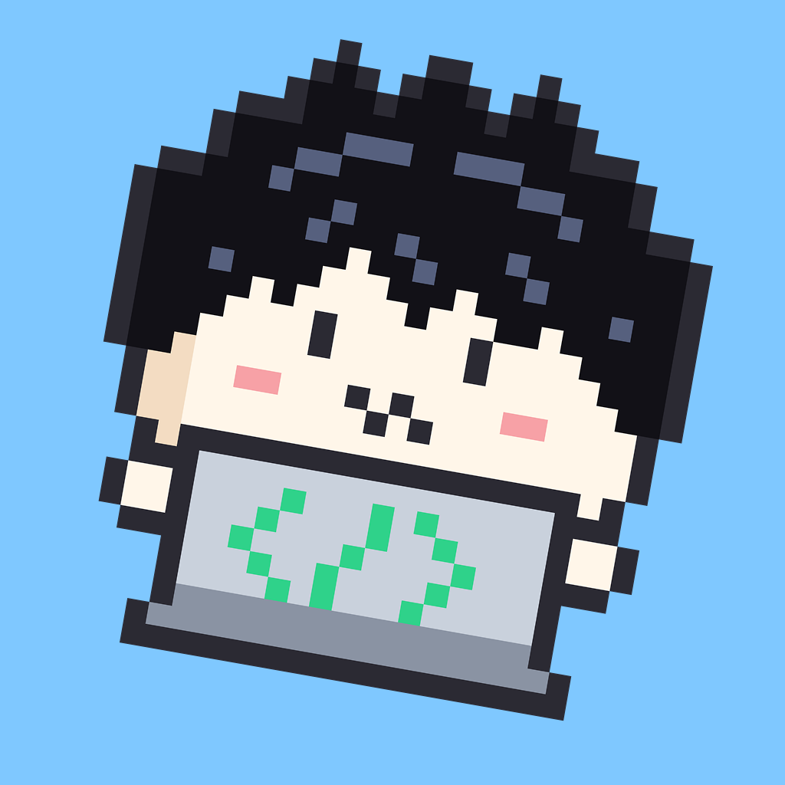

# 👋 こんにちは、こうちゃです

情報工学科の1年生です。新しい知識しか入ってこないので、なんでも挑戦中です。

## 🙋 自己紹介

| 項目 | 内容 |
|---|---|
| 所属 | 情報工学科・1年　じょぎ |
| 好きなこと | 音楽鑑賞、アニメ鑑賞 |
| 好きなアニメ | キングダム、葬送のフリーレン |
| 今の目標 | セキュリティの分野の知識、技術を得る |

## 🛠️ これから作りたいもの

- 大学で生活する上でよく使っているツール
- ホームページ

## 💬 座右の銘

> 失敗は成功のもと

## 🔗 My Account

## 📊 GitHub Stats

